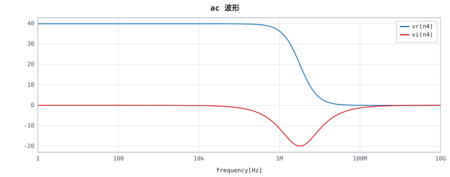
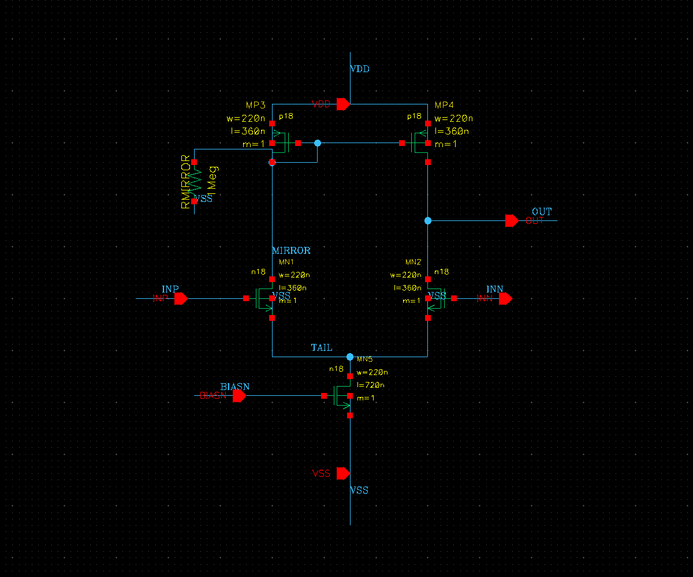

# AetherPilot

面向华大九天 Aether 模拟设计平台的 Python 二次开发治理与 AI 接入底座——把「能调用 Aether」变成「能可信、可复核、可恢复地驱动 Aether」。

Aether 平台的 PyAether 接口提供数据库与仿真器的单步原语。AetherPilot 在其上构建完整治理层：使用者或 AI 助手提交结构化计划（纯 JSON，禁止携带命令与表达式），底座严格校验后事务化执行（暂存区+备份+崩溃恢复日志），执行后回读数据库逐字段比对，全过程证据以 SHA-256 清单封存。任何一步失败都停在明确的机器可读错误上，绝不把半成品留在设计库里。

## 功能亮点

| 功能域 | 能力 | 说明与入口 |
| --- | --- | --- |
| 计划与校验 | 声明式 JSON 计划 | 字段白名单、重复键拒绝、注入防护、网格与正交检查；`python -m aetherpilot validate <plan>` |
| 变更与恢复 | 四阶段事务 | 校验→预备→发布→恢复，暂存区+备份+崩溃日志；破坏性操作需显式批准 |
| 证据与快照 | SHA-256 证据链 | 逐文件原子写入+清单、自动脱敏、资源预算；快照依赖闭包+隔离重开验证 |
| 原理图可读性 | 检查器 + 生成侧约定 + 布局配方库 | 让自动生成的原理图结构可读：17 条机器可执行风格规则只读核查（违例失败闭环、配方豁免可见、真实符号几何口径）；引脚分区拉线打标签、电源逐端子短桩、自动网名语义派生（连接经原生网表实证不变）；布局配方以角色映射、端子对齐与局部布线模板紧凑成图，连接前提逐条校验、拓扑保持经保存重开比对；入口 `lint` 与 `compose` |
| 布局与重画 | 风格驱动布局 + 一键重画 | 布局求解器内置风格规则；`recreate` 重排统一网格，拓扑哈希等价校验后发布 |
| 自然语言 | 确定性建图 | 认证模板（五管 OTA/差分对/反相器）+ 通用器件文法，逐行诊断拒绝；`natural-apply` |
| 仿真 | 五类分析实验编排 | op/dc/ac/tran/noise、条件扫描、工艺角、双蒙特卡洛、可选并发；`simulate` |
| Maestro/MDE | 仿真环境治理 | 会话、持久作业、网表、运行、结果回读、波形导出、配置迁移与恢复 |
| 证据报告 | 自包含 HTML | 设计概览+电路草图+波形+规格判定+审查发现+证据清单；`report` 命令 |
| 只读审查 | Reviewer | 结构识别、工作区/匹配性核对、工作点配对，结论诚实分级；`scripts/reproduce_review.py` |
| Agent 接入 | skill 包 + MCP | Agent 操作手册 + 标准 MCP 接口（只读默认开放、写工具强制批准）；`mcp` 命令 |
| 文档检索 | 零依赖全文检索 | SQLite FTS5 索引，秒级定位接口用法；`docs-index`/`docs-search` |
| 网表 | 互换/迁移/层次物化 | 扁平精确往返、层次解析、跨工艺库迁移审批、一键物化成库（失败回滚） |

## 使用示例：五管 OTA 从一句话到可读原理图与仿真证据

以「创建一个五管OTA」为例走一遍完整链路（全部步骤在真实 Aether 环境逐项验收）。

1. **prompt 输入**：用户或 Agent 给出自然语言描述「创建一个五管OTA」（也接受等价结构化 JSON 计划）。
2. **任务解析（确定性编译，非 LLM 臆造）**：`natural_language_to_plan()`（`natural_language.py`）命中认证模板，编译出结构化计划——6 个器件（MN1/MN2 差分对、MP3/MP4 镜像负载、MN5 尾管、RMIRROR 偏置电阻）与 6 个引脚（INP/INN/OUT/VDD/VSS/BIASN）及其连接关系。约束：器件与语句白名单、字段白名单校验、注入防护；不支持的表述逐行诊断并拒绝。
3. **工具调用（事务化执行）**：`compose_structured()` 经 Harness 校验后交给独立 worker 子进程（`worker.py`）在 Aether 产品 Python 内执行。约束：目标 cell 必须不存在（不覆盖既有设计）、库锁与工作区锁、时间/内存/磁盘预算、失败即停在机器可读错误。
4. **原理图绘制（结构化组合）**：`compose_ota5()`（`layout_recipes.py` 的 ota5 配方）先做角色与连接前提校验——显式角色映射（缺角色报 `role_unassigned`、一器件两角色报 `role_conflict`、多出器件报 `role_unconfirmed`）、共源/镜像/二极管连接前提（不符报 `recipe_mismatch`）；再用真实符号端子几何（`master_geometry`）验证器件朝向（输入对栅朝外、镜像负载栅朝内），按支路漏极同列反解器件原点、尾管居中；布线走局部模板（顶部 VDD 轨、左右 drain 竖列、镜像控制线、二极管就近连接、公共源汇合条中点下接尾管、左右侧输入、右侧输出、就近偏置）。引脚由 `pin_lead_wires()` 拉出短引线并打网络标签（方向约定 + 12 候选避障选举，全占报 `lead_blocked`）。约束：0.0625 工艺网格、器件体碰撞检查（端子接近区豁免合法接触）、`compile_wires` 电气编译（异网交叉/悬空端子即拒）。
5. **验证（四层）**：
   - 计划阶段：拓扑 digest 与模板一致（`placement.topology` + `contract.digest`），不改电路才允许写入；
   - 写入后：`dbCheckAndSaveDesign` 原生检查，保存重开回读，连接/引脚/网络/端口序严格一致、声明参数逐项包含（`_compose_topology_mismatch`，原生落库实体化的 CDF 默认值不算差异）；
   - 可读性：`lint_schematic(masters=...)` 17 条规则零违例（真实符号体口径）；
   - 确定性：同一输入二次组合，几何逐点一致。
6. **仿真与证据**：`simulate` 跑 AC 分析，结果规范化后提取指标；截图与全部中间产物以 SHA-256 清单封存进证据目录，`report` 生成自包含 HTML 报告。

可读性实测（拓扑不变）：总线长 137.4 → 15.8（8.7 倍收紧）、核心区域 22.1H×38.3H → 6.2H×6.6H、弯折 43 → 20、最长分支 22.7 → 1.125。

仿真实测：

| 指标 | 实测值 |
| --- | --- |
| 低频增益 | 32.01 dB |
| 单位增益带宽 UGBW | 128.0 MHz |
| 相位裕度 PM | 89.17° |
| 输入对宽度扫描 | 2u/4u/8u → 31.0/32.0/33.0 dB（单调，物理方向正确） |

AC 幅频响应（仿真结果规范化后渲染）：



原生画布截图（结构化组合后的 OTA5：上方镜像负载、左右输入支路、中央尾管、就近偏置，拓扑与仿真电路完全一致）：



## 快速开始

```bash
cp config.example.json local-config.json   # 填写自己的 backend、环境、workspace、PDK、模型与输出目录
python -m aetherpilot backend-status --config local-config.json   # 无副作用静态探测
python -m aetherpilot capabilities                                 # 能力声明
scripts/run-unit-tests.sh                                          # 公开离线测试
```

`local-config.json` 只在使用者本地保存，不应提交。完整字段与部署顺序见 [部署说明](docs/deployment.md)。

## 未来优化方向

- 致密多行核心的布线器增强（rip-up 重布与多层布线）。
- 布局配方库扩展：两级运放、反馈型 TIA、自举采样开关等结构的配方化（依赖真实样例与角色确认）。
- 周期稳态等更多分析类型的接入（沿仿真器波形导出路线）。
- 随官方工艺库演进，接入更完整的器件模型与统计模型能力。
- 无头环境下原理图截图的符号级渲染增强。
- 更多认证电路模板与更丰富的自然语言句式。

## 边界与许可

公开核心不承诺任意工艺、任意厂商语法、物理签核、远程主机控制或未声明的 EDA 操作；工艺规则、器件模型与环境配置由使用者在自己的 backend 中提供。公开源码采用 MIT License（版权归 `AetherPilot contributors`）；外部厂商软件、工艺库、模型、许可证和任何本机运行材料不由本许可证再授权。
